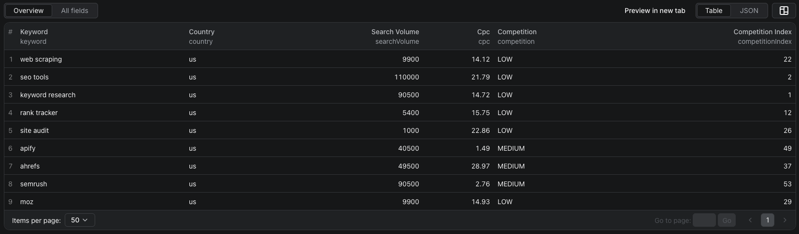

# How to Check Google Keyword Search Volume in Node.js

This example calls the [Google Keyword Volume Scraper](https://apify.com/piotrv1001/google-keyword-volume-scraper) on Apify. It uses the existing Actor; it does not implement a scraper.



The screenshot is from a separate nine-keyword run. The code below uses a smaller three-keyword starter input.

## What this example does

- Sends three keywords to the Actor for the US market.
- Waits for the run to finish.
- Reads and prints the dataset rows.

The output can include average monthly search volume, a 12-month history, CPC, ad competition, and top-of-page bid estimates. Ad competition is not organic keyword difficulty.

## Prerequisites

- Node.js 18 or newer
- An Apify account and [API token](https://console.apify.com/settings/integrations)

## Installation

```bash
npm install
```

## Environment setup

Copy `.env.example` to `.env` and replace the placeholder with your token.

## Usage

```bash
npm start
```

The Actor bills per keyword with data and per lookup batch. See its [live pricing](https://apify.com/piotrv1001/google-keyword-volume-scraper/pricing) before increasing the list.

## Code example

```js
import { ApifyClient } from 'apify-client';
import 'dotenv/config';

if (!process.env.APIFY_TOKEN) {
    throw new Error('Set APIFY_TOKEN in .env before running this example.');
}

const client = new ApifyClient({ token: process.env.APIFY_TOKEN });

const input = {
    keywords: ['running shoes', 'trail running shoes', 'running shoes for flat feet'],
    country: 'us',
    maxItems: 3,
};

const run = await client.actor('piotrv1001/google-keyword-volume-scraper').call(input);

console.log('Results from dataset');
console.log(`Check your data here: https://console.apify.com/storage/datasets/${run.defaultDatasetId}`);
const { items } = await client.dataset(run.defaultDatasetId).listItems();
items.forEach((item) => console.dir(item));

// API client docs: https://docs.apify.com/api/client/js/docs
```

## Example output

[`sample-output.json`](sample-output.json) contains **illustrative mock values**, not a captured run. It shows the expected field shape. A real row has 12 entries in `monthlySearches`; the mock file abbreviates that array. Keywords without Google volume data may not produce a row.

## Use cases

- Compare demand for a content shortlist.
- Spot seasonal keywords from monthly history.
- Add paid-search cost signals to a keyword spreadsheet.
- Check the same list across country-specific runs.

## Try the Actor on Apify

**[Open Google Keyword Volume Scraper on Apify](https://apify.com/piotrv1001/google-keyword-volume-scraper)**

## Related resources

- [How to check Google keyword search volume in bulk](https://www.falconscrape.com/blog/how-to-check-google-keyword-search-volume-in-bulk)

## License

MIT
